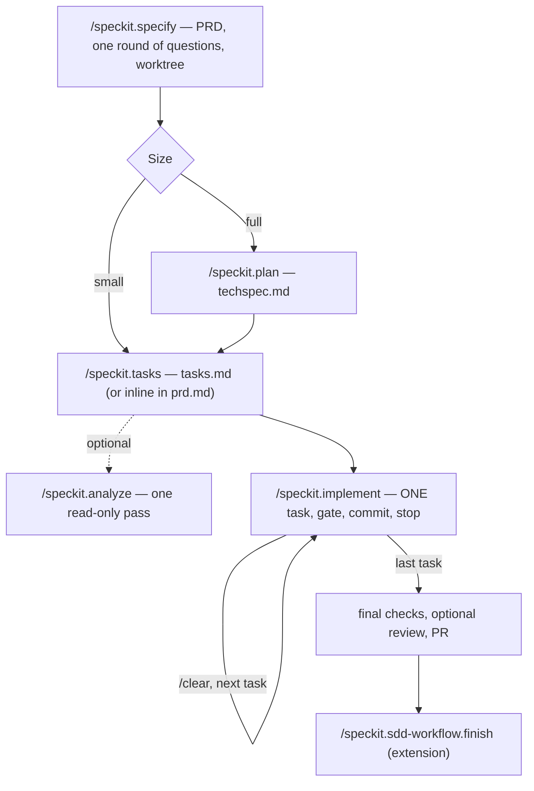

# spec-kit-preset-sdd-workflow

A [Spec Kit](https://github.com/github/spec-kit) preset that replaces the core
workflow commands with a lean **Spec-Driven Development (SDD)** workflow.

The pieces that keep quality are a test gate before every commit, your approval
of the PRD, techspec and task list, and one task per session. Everything else
is kept small so sessions stay cheap. Each command is at most 3 KB, and nothing
else is loaded on every call.

## Flow



Run `/clear` between commands. Each command reads only the documents it needs,
and the task state lives in the files, not in the session.

## Commands

| Command | Produces | Approval |
|---------|----------|----------|
| `/speckit.specify` | `specs/[slug]/prd.md`, worktree `.worktrees/[slug]`, `docs/kanban/feature-[slug].md` | PRD |
| `/speckit.clarify` (optional) | patched `prd.md` | if scope changes |
| `/speckit.plan` (full only) | `techspec.md` | techspec |
| `/speckit.tasks` | `tasks.md`, or inline tasks for small features | task list |
| `/speckit.analyze` (optional) | an inline report; HIGH/CRITICAL block | — |
| `/speckit.implement` | one task: code, tests and tracking in a single commit; on the last task, the PR | — (the gate replaces it) |

## Document format

```markdown
**Size:** small | full
**Approved:** 2026-11-09 — user: "ok"
- RF-01: Users can save drafts.
- AC-01 (RF-01): When saving valid content, the system shall persist the draft.
```

Tasks are `## T1 — Title` sections with `**Status:**`, `**Requirements:**`,
`**Criteria:**`, `**Depends on:**`, `**Files:**` and `**Gate:**` fields. The plan
has a `**Final gate:**` and a `## Checks` table (`Criterion | Task | Proof command`)
with one row per AC. See `commands/speckit.tasks.md`.

## Helper script

`scripts/sdd.py` (Python 3.8+, standard library only) is installed at
`.specify/presets/sdd-workflow/scripts/sdd.py`:

```bash
python3 .specify/presets/sdd-workflow/scripts/sdd.py validate my-feature           # structure, approvals, next task
python3 .specify/presets/sdd-workflow/scripts/sdd.py check my-feature --task T2    # task gate
python3 .specify/presets/sdd-workflow/scripts/sdd.py check my-feature --baseline   # final gate before the first task
python3 .specify/presets/sdd-workflow/scripts/sdd.py check my-feature --final      # all proofs plus the final gate
```

`check` prints `PASS <command>` or the failing command with its last 40 lines.

## Installation

```bash
specify preset add sdd-workflow --from https://github.com/fabfdev/spec-kit-preset-sdd-workflow/archive/refs/tags/v4.0.0.zip
specify extension add sdd-workflow --from https://github.com/fabfdev/spec-kit-extension-sdd-workflow/archive/refs/tags/v4.0.0.zip
```

For a local checkout, use `specify preset add sdd-workflow --dev <path>`. To
update every project and the global `~/.agents/skills` copies at once, use the
extension's `scripts/update_installations.py`, which previews by default.

## Upgrading

- **From 3.x:** the v3 files in a feature folder (`analysis-*.json`, `proofs.json`,
  `execution.json`, `verification.json`, `usage.jsonl`) are ignored and can be
  deleted. v3 `tasks.md` files, including the 4-column Checks table, still work.
- **From 2.x:** features that still use `N_task.md` files are implemented from
  those files, and the project tests are run directly. New features use
  `tasks.md`.

See `CHANGELOG.md`. Companion extension:
[spec-kit-extension-sdd-workflow](https://github.com/fabfdev/spec-kit-extension-sdd-workflow).

## License

MIT
